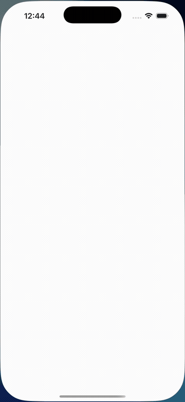
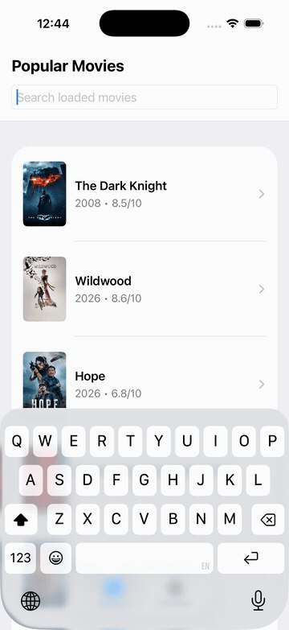
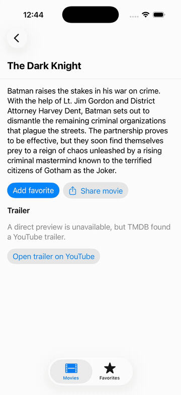

# MovieDemo Swift v2

I come from the .NET MAUI world, where I usually ask a very specific question
when the UI changes: **which value changed, who published it, and which control
reacted?** I built this small iOS movie app to answer the same question in
SwiftUI while getting my hands on UIKit, Combine, and a few architecture
patterns I wanted to understand better.

The app browses movies from [TMDB](https://www.themoviedb.org), saves favorites
on the device, and gives me a real screen to test these ideas. The RxSwift and
Uber RIBs examples live in separate packages so I can compare them without
turning the main app into an architecture buffet.

## What can you try?

- Browse popular movies, with more pages loaded as you reach the end.
- Search **titles already loaded** in the list. Combine waits 250 ms after
  typing before it filters the rows.
- Open a movie, read its overview, and add or remove it from Favorites.
- Play a matching Apple movie preview when one is available, or open a TMDB
  YouTube trailer link when direct playback is unavailable.
- Share a movie through the native iOS share sheet.

The main app has three screens: Movies, Favorites, and Movie Details. It uses
its own bundle ID and Home Screen name, so it can sit beside the original
MovieDemo on the same simulator.

## Why these pieces?

### MVVM, with the values in plain sight

`MoviesViewModel` is `@MainActor` isolated. When a page arrives, it assigns
`movies`, `currentPage`, and `totalPages`. The Combine search pipeline combines
`movies` with `searchText` and publishes `visibleMovies`. The SwiftUI `List`
reads `visibleMovies` and uses each movie's ID to identify its rows.

That is the same kind of cause-and-effect trail I look for in MAUI: a ViewModel
property changes, the bound UI is notified, and a specific control updates.
Loading, empty, content, and error cases are separate; a failed next page
keeps the rows I already have and offers Retry.

### Dependency injection, one feature at a time



The Movies feed uses [Point-Free Dependencies](https://github.com/pointfreeco/swift-dependencies)
for `MovieFeedClient`. It has a live TMDB implementation, a preview movie, and
a test value that makes a missing override obvious. In tests, I replace it
with a fake using `withDependencies`.

Details and Favorites still receive repository protocols from `AppContainer`.
I kept this change narrow so it is easy to see what the dependency library
adds.

### Combine for typing; async/await for requests



Search is an ongoing stream of text edits, so `$searchText` is a useful
`Publisher`. It goes through `debounce`, duplicate removal, and title
filtering before `sink` assigns `visibleMovies`. An `AnyCancellable` keeps
the subscription alive for the ViewModel's lifetime.

The TMDB calls, trailer lookup, and SQLite work are one-shot operations, so
they stay on `async`/`await`. I do not send network or database work through a
SwiftUI View.

### UIKit where it makes sense



Movie Details presents `UIActivityViewController` through
`UIViewControllerRepresentable`. SwiftUI owns the share button and whether
the sheet is open; UIKit provides the native sharing controller.

Favorites are stored with SQLite3 inside an actor. A small JSON repository
remembers the selected tab and last successful page. Movie previews use
`AVPlayer` and SwiftUI's `VideoPlayer`.

## The side exercises

I wanted to compare the same ideas without running two search pipelines or
two navigation architectures in the app:

| Exercise | What I am practicing |
| --- | --- |
| [RxSearch](ArchitectureExercises/RxSearch) | An isolated version of title search with `Observable`, `debounce`, a supplied scheduler, `subscribe`, and `DisposeBag`. |
| [RIBsMovies](ArchitectureExercises/RIBsMovies) | A small Movies → Details tree with Uber RIBs Builder, Interactor, and Router. The test checks child attach and detach. |

[ARCHITECTURE_TRAINING.md](ARCHITECTURE_TRAINING.md) walks through those
examples with more detail and maps them back to my MAUI mental model. The
original step-by-step practice plan is in [TRAINING_PLAN.md](TRAINING_PLAN.md).

## Let's run it

You need macOS, Xcode with Swift 6.1 or newer, and an iPhone simulator. The
deployment target is iOS 17.0; I validated the project with Xcode 26.5 and
an iPhone 17 Pro simulator.

1. Clone this repository and open `MovieDemoSwift.xcodeproj`.
2. Get a TMDB **API Read Access Token** from your
   [TMDB API settings](https://www.themoviedb.org/settings/api).
3. Copy `Configuration/Secrets.example.xcconfig` to
   `Configuration/Secrets.xcconfig`, then replace the placeholder with your
   token. [API_TOKEN_SETUP.md](API_TOKEN_SETUP.md) has the exact steps.
4. Select the `MovieDemoSwift` scheme and run it on an iPhone simulator.

The app builds without the token, but live TMDB calls show a configuration
error. The tests use fakes, so they do not need a token.

### Run the tests

From the repository root:

```sh
xcodebuild -project MovieDemoSwift.xcodeproj -scheme MovieDemoSwift \
  -destination 'platform=iOS Simulator,name=iPhone 17 Pro,OS=26.5' \
  test CODE_SIGNING_ALLOWED=NO
```

Use another installed simulator name and OS if yours differ. For the
separate exercises:

```sh
cd ArchitectureExercises/RxSearch
swift test
```

```sh
cd ArchitectureExercises/RIBsMovies
xcodebuild -scheme RIBsMoviesExercise \
  -destination 'platform=iOS Simulator,name=iPhone 17 Pro,OS=26.5' \
  test CODE_SIGNING_ALLOWED=NO
```

My last local check on 2026-10-30 passed **18 main-app tests**, **1 RxSwift
test**, and **1 RIBs test**. I also checked the live feed, posters, and local
title search in the simulator.

## What I would avoid

- **Treating local search as a full TMDB search.** It filters only movie
  titles already loaded into `MoviesViewModel`.
- **Calling the local token a production secret.** `Secrets.xcconfig` is
  ignored by Git, but its value is embedded in a local app build. I would put
  a backend between a distributed app and third-party credentials.
- **Assuming every trailer will play inside the app.** The Apple preview
  needs a matching title and year; otherwise the app offers an external
  YouTube link when TMDB provides one.
- **Claiming the side exercises are the app architecture.** RxSwift and RIBs
  are isolated practice packages. The working app uses MVVM and Combine.

There is still room for UI tests, accessibility verification, localization,
offline caching, retry/backoff rules, and a SQLite migration strategy. That
is future work for this practice project.

## Project map

```text
MovieDemoSwift/
├── App/            SwiftUI screens, navigation, UIKit share sheet, player
├── Core/           Models, repository protocols, pure policies
├── Data/           TMDB and Apple clients, SQLite, JSON, feed dependency
└── Presentation/   @MainActor ViewModels
MovieDemoSwiftTests/  App and ViewModel tests
ArchitectureExercises/
├── RxSearch/        Isolated RxSwift package and test
└── RIBsMovies/      Isolated Uber RIBs package and test
Configuration/       Build settings and ignored local token
```

The app icon source is in [branding](branding). The repository is available
under the [MIT License](LICENSE).

## Credits

Movie data and posters come from [The Movie Database (TMDB)](https://www.themoviedb.org).
This product uses the TMDB API but is not endorsed or certified by TMDB.
Before distributing the app, I would add TMDB's required in-app About/Credits
attribution and approved logo, as described in the [TMDB FAQ](https://developer.themoviedb.org/docs/faq).
